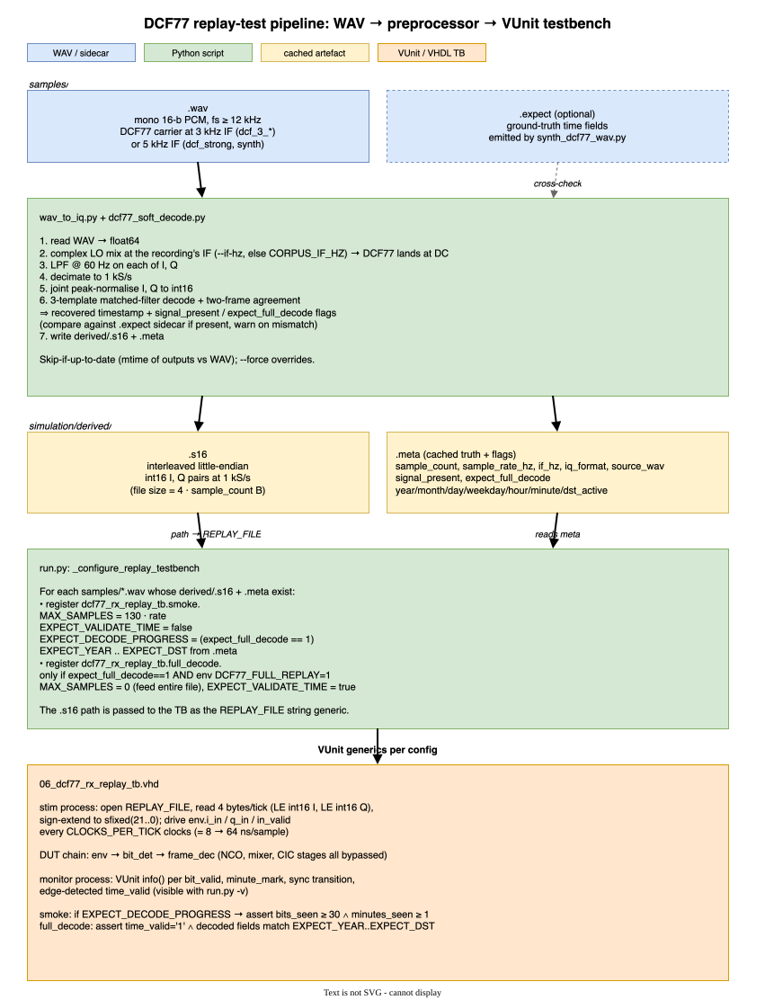
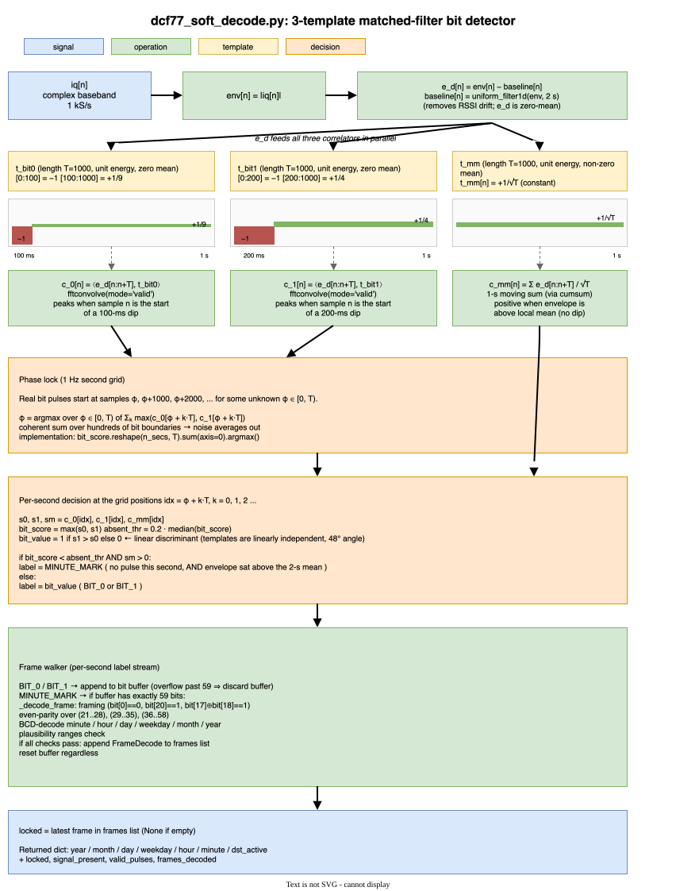

# DCF77 Receiver/Decoder

VHDL-2008 implementation of a DCF77 (77.5 kHz longwave time-signal) AM
receiver and frame decoder, packaged as an AXI4-Lite peripheral.  Target is
AMD/Xilinx Artix-7 200 at a 125 MHz system clock; the ADC stream is 14-bit
signed samples at 125 MS/s.

## Architecture

Signal-processing chain — decimate first, mix later.  Only one carry chain
runs at full 125 MHz timing; the inner CIC stages live behind
`set_multicycle_path` constraints.

```
adc[14b, 125 MS/s]
   ▼
CIC₀  (N=3, R=2,  M=1)        17 b integrators @ 125 MHz, single-cycle
   ▼  62.5 MS/s
CIC₁  (N=3, R=10, M=1)        29 b integ / 26 b comb (Hogenauer-pruned)
   ▼  6.25 MS/s
CIC₂  (N=3, R=25, M=1)        33 b integ / 26 b comb
   ▼  250 kS/s, 22 b signed (real-valued, carrier still at 77.5 kHz)
sign-LO mixer ◀── NCO (18 b phase acc, 77.5 kHz, ±0.04 Hz)
   ▼ I, Q (22 b each) @ 250 kS/s
CIC₃_I, CIC₃_Q  (N=3, R=10)   30 b integ / 26 b comb, multicycle 500
   ▼ I, Q (22 b each) @ 25 kS/s  ── PM hook (iq_tap_out)
CIC₄_I, CIC₄_Q  (N=3, R=25)   33 b integ / 26 b comb, multicycle 5000
   ▼ I, Q (22 b each) @ 1 kS/s
power = I² + Q² (1 × DSP48E1, MAC time-shared)
   ▼
adaptive threshold + env_min trough + noise-MAD IIR
   ▼ digital pulse
pulse-width FSM @ 1 kS/s:  100 ms±10 ms → bit 0,  200 ms±10 ms → bit 1,
                            no absenkung in expected window → minute mark
   ▼
59-bit frame buffer
   ▼
BCD + parity + plausibility checks  (per doc/dcf77_format_spec.md)
   ▼
AXI4-Lite slave  (10 registers)
```

The post-mixer I/Q is also exposed as a `dcf77_iq_tap_type` port at
25 kS/s for a future PM (BPSK / m-sequence) correlator (~49 samples per
PM chip, far above the typical 4–16 samples/chip budget).

Design decisions are described in
`/Users/eligs/.claude/plans/this-project-aims-to-toasty-pelican.md`; CIC
internal widths come from the Hogenauer analysis emitted by
`simulation/scripts/cic_pruning.py`.

## Repository layout

```
inc/                shared packages (compiled first)
  dcf77_pkg.vhd            types, register map, pack/unpack helpers
  dcf77_cic_widths_pkg.vhd CIC widths (generated, see below)
  axi4lite_interface_pkg.vhd channel record types

src/dcf77/          RTL
  dcf77_cic_dec.vhd        generic CIC building block (instantiated 7×:
                            3 pre-mixer real + 2×2 post-mixer complex)
  dcf77_nco.vhd            18 b phase-accumulator DDS, sign-only I/Q outputs
  dcf77_mixer.vhd          22 b cond-negate I/Q
  dcf77_env.vhd            I²+Q² with time-shared DSP48E1 MAC
  dcf77_bit_det.vhd        adaptive threshold + pulse-width FSM + sync state
  dcf77_frame_dec.vhd      59-bit buffer + BCD/parity decoder
  dcf77_core.vhd           top-level RTL wiring (no AXI here)
  axi_readmux.vhd          AXI4-Lite read-channel decoder
  axi_writemux.vhd         AXI4-Lite write-channel decoder
  dcf77_axi_lite.vhd       top-level shell: core + readmux + writemux + flat AXI ports

constraints/
  dcf77.xdc                set_multicycle_path for CIC₁ (×2) / CIC₂ (×20)
                           and CIC₃ (×500) / CIC₄ (×5000); false_path on
                           the slow bit-det IIRs (env_max, env_min, noise,
                           threshold, hyst)

simulation/scripts/
  run.py                   VUnit runner (also registers TB configurations)
  cic_pruning.py           Hogenauer width / SNR analysis (see "Tools" below)

simulation/tb/             VUnit testbenches (00..10_)
doc/                       protocol spec + Gaisler papers + AXI reference
```

## Coding style

Follows the Gaisler structured two-process method (see `doc/structdes.pdf`
and `doc/vhdl2proc.pdf`):

* one combinational and one sequential process per entity;
* one register record (`r`, `rin`) holding all flip-flops; ports use
  records grouped by direction;
* sequential statements (loops, case, if/elsif) inside the combinational
  process — no concurrent dataflow tangle;
* signal-processing nets are `ieee.fixed_pkg` `sfixed` / `ufixed` with
  explicit `(high downto low)` ranges so LSB scale is encoded in the type;
* counters and bit-vectors stay on plain `unsigned` / `std_logic_vector`.

## Running the test suite

```sh
# Activate a venv with `vunit_hdl` installed first.
python3 simulation/scripts/run.py            # run all 31 tests
python3 simulation/scripts/run.py --list     # list tests without running
python3 simulation/scripts/run.py "*nco*"    # filter by name
python3 simulation/scripts/run.py --clean    # rebuild from scratch
```

Tests run under GHDL with `--std=08 -fsynopsys -frelaxed`.  Build
artefacts land in `vunit_out/` (gitignored).  Total runtime ≈ 35 s.

## Documentation

The README is developer-facing.  For integrator-oriented documentation
(top-level interface, generics, register address map with per-bit
field tables, operational notes, SNR computation, sync-state machine,
resource footprint, software pseudo-code) see
[**`doc/dcf77_receiver_reference.md`**](doc/dcf77_receiver_reference.md).

The DCF77 protocol itself (AM frame layout, BCD encoding, parity rules,
PM hints) is documented in [`doc/dcf77_format_spec.md`](doc/dcf77_format_spec.md).

## AXI4-Lite register map

| Offset | RW | Name        | Layout                                                    |
| ------ | -- | ----------- | --------------------------------------------------------- |
| 0x00   | RW | CTRL        | bit 0 enable (sticky), bit 1 soft_reset (1-clock pulse)   |
| 0x04   | R  | STATUS      | 1..0 sync_state, 2 time_valid, 13..8 bit_index, 31..16 RSSI |
| 0x08   | R  | TIME_HMS    | 5..0 minute, 12..8 hour                                   |
| 0x0C   | R  | DATE        | 7..0 year, 11..8 month, 20..16 day, 26..24 weekday        |
| 0x10   | R  | FLAGS       | 0 dst_active, 1 dst_announce, 2 leap_announce             |
| 0x14   | R  | RSSI        | 15..0 magnitude (top 16 b of env_max)                     |
| 0x18   | R  | LAST_FRAME0 | raw frame bits 0..31                                      |
| 0x1C   | R  | LAST_FRAME1 | raw frame bits 32..58                                     |
| 0x20   | R  | ENV_MIN     | 15..0 magnitude (top 16 b of env_min trough tracker)      |
| 0x24   | R  | NOISE       | 15..0 magnitude (top 16 b of noise-MAD IIR)               |

`SNR_dB ≈ 20·log10((RSSI − ENV_MIN) / NOISE)` — the host reads the three
fields and computes the dB value at audio cadence.

`sync_state` encoding: `00` = search, `01` = lock, `10` = hold.  After
`T_HOLD_SEC` (default 120 s) without a minute mark the state falls from
`lock` to `hold`; after `T_SEARCH_SEC` (default 300 s) it falls to
`search`.  Reads of addresses ≥ 0x20 return DECERR; writes to any
read-only offset return SLVERR.

## Replay test — decoding a real recording

The receiver back end can be exercised against real DCF77 recordings.
The replay testbench injects pre-decimated complex baseband **at the
1 kS/s I/Q boundary**, directly feeding `dcf77_env` — the NCO, mixer
and post-mixer CIC stages are bypassed, so the same back-end logic
runs ~250× faster than feeding the full signal chain.  A 4-minute
clip decodes in seconds.



Drop a WAV into `samples/`, run the preprocessor, run the regression:

```sh
# Drop in your own WAV (mono real-valued, ≥ 12 kHz, DCF77 at 5 kHz IF).
cp my_dcf77_recording.wav samples/

# (Optional) synthetic recording for self-testing.
python3 simulation/scripts/synth_dcf77_wav.py    # writes samples/synth.wav

# Preprocess every WAV in samples/ into simulation/derived/<stem>.{s16,meta}.
# Idempotent: skips WAVs whose outputs are newer.  Use --force to re-run.
python3 simulation/scripts/wav_to_iq.py --all

# Run the replay testbench (registered once per prepared WAV).
python3 simulation/scripts/run.py "*rx_replay*"
```

The preprocessor:

1. Mixes the WAV down with a complex LO at `--if-hz` (default 5000 Hz)
   so the DCF77 carrier lands at DC.
2. Low-passes (60 Hz) and decimates to **1 kS/s**.
3. Writes interleaved little-endian int16 I/Q pairs to `*.s16`.
4. Runs its **own software DCF77 decoder** (`dcf77_soft_decode.py`,
   see [§ Soft decoder internals](#soft-decoder-internals)) on the
   same I/Q stream and caches the recovered timestamp in `*.meta`.

Two replay tests are registered per WAV when its `.s16`/`.meta` exist:

* **`smoke`** — feeds the first 130 s of the recording.  If the soft
  decoder locked, asserts `bits_seen ≥ 30` and `minutes_seen ≥ 1`;
  otherwise just verifies the pipeline runs end-to-end.
* **`full_decode`** — feeds the entire recording, asserts the decoded
  fields match the reference time the Python decoder recovered from
  the same audio.  Only registered when the preprocessor locked
  (`expect_full_decode=1` in the meta) **and** the
  `DCF77_FULL_REPLAY=1` environment variable is set.

  ```sh
  DCF77_FULL_REPLAY=1 python3 simulation/scripts/run.py "*rx_replay*full*"
  ```

WAVs that the Python decoder couldn't decode (weak / noisy recordings)
still get a smoke config — only the full-decode validation is skipped
for them.  Additionally, when `expect_full_decode=0` in the .meta the
smoke config drops the `bits_seen >= 30` / `minutes_seen >= 1` assertion
so the pipeline still runs end-to-end without the regression failing on
the receiver's decode limits.  The TB log line
`EXPECT_DECODE_PROGRESS=false; ...` makes the relaxed mode explicit.

### Soft decoder internals

`dcf77_soft_decode.py` recovers the embedded timestamp via a three-template
matched filter on the same 1 kS/s I/Q stream the testbench will inject.
Two pulse-shape templates (`t_bit0`, `t_bit1`) score "how dip-like is this
second's envelope?", a third constant template (`t_mm`) confirms "envelope
sat above the local mean = no dip = minute mark".  Phase lock for the
1 Hz second grid falls out of a coherent sum across the whole recording;
per-second decisions are then assembled into 59-bit frames and validated
by framing + parity + plausibility checks.



The bit templates are linearly independent but not orthogonal (inner
product ≈ 0.667, ~48° angle), so `argmax(c_0, c_1)` discriminates by
linear-discriminant margin rather than by orthogonal projection — about
5 dB shy of the optimal orthogonalised pair.  A single parity-good,
plausibility-passing frame is enough to lock; the matched filter's
implicit coherent averaging makes false locks vanishingly unlikely.

### Verbose decode logging

Pass `-v` to `run.py` (forwarded to VUnit) to surface the per-bit /
per-minute info() log lines the testbench emits:

```sh
python3 simulation/scripts/run.py -v "*rx_replay*smoke*"
```

Sample (truncated):

```
INFO - sync_state SEARCH -> LOCK at 1234567 ns
INFO - bit 0 = '0' sync=LOCK (#1)
INFO - bit 1 = '1' sync=LOCK (#2)
...
INFO - minute_mark (#1, bits_seen=59)
INFO - time_valid: 26-5-13 (Wed) 11:42 dst='1'
```

### Synthetic test signal

`synth_dcf77_wav.py` writes to `samples/synth.wav` by default and
also drops a `samples/synth.expect` sidecar carrying the
ground-truth time fields.  `wav_to_iq.py --all` picks the sidecar up
automatically and cross-checks its Python decoder against the truth,
surfacing a loud warning if they ever disagree — a regression alarm
for the soft-decoder logic.

The replay tests are silently skipped if `samples/` is empty or no
`.s16`/`.meta` artefacts exist for the WAVs found there, so the core
suite remains runnable without them.

## Tools — `cic_pruning.py`

This script computed the per-stage CIC widths in
`inc/dcf77_cic_widths_pkg.vhd` from the design parameters (R=2/16/16,
N=3, M=1, input 14 b, output 22 b) using a Hogenauer-style L2-norm noise
analysis.  The output is **checked into the repository**; the script is
kept for reproducibility but does not need to run on every build.

Re-run it only when the CIC topology changes:

```sh
python3 simulation/scripts/cic_pruning.py
```

The script has no external dependencies (pure Python) and emits both the
VHDL constants package and a plain-text width / SNR report under
`simulation/derived/`.

## Integration notes

* The slave is in the `s_axi_aclk` clock domain.  `dcf77_core` assumes
  `adc_valid` and `adc_sample` are synchronous to the same clock.  If the
  ADC has its own clock, add a CDC FIFO upstream of this entity.
* `set_multicycle_path` in `constraints/dcf77.xdc` uses wildcards on the
  CIC instance names (`*u_cic1*`, `*u_cic2*`); review after the first
  Vivado place-and-route to confirm the hierarchical paths resolve.
* The host's `soft_reset` bit and the external `!aresetn` are OR-combined
  inside `dcf77_axi_lite` to drive the synchronous reset of
  `dcf77_core` — no separate reset distribution.

## Known limitations

* AM only.  PM (BPSK / m-sequence) is out of scope; the I/Q tap port is
  exposed so a future PM correlator can attach there.
* End-to-end functional verification is a single scaled-down bit;
  a full-minute synthetic test would require either a long sim run or
  drastically scaled bit_det generics.
* No interrupt line is generated.  The host polls STATUS for time_valid.
* Sticky enable, pulsing soft_reset.  No watchdog on dropouts beyond the
  sync-state demotion sequence (`lock → hold → search`).
