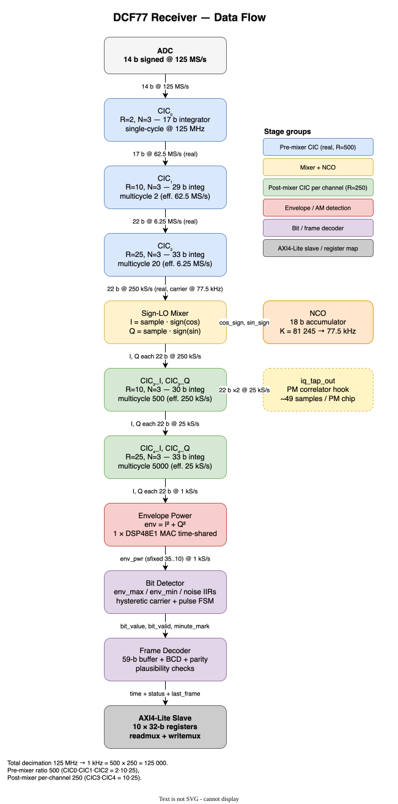
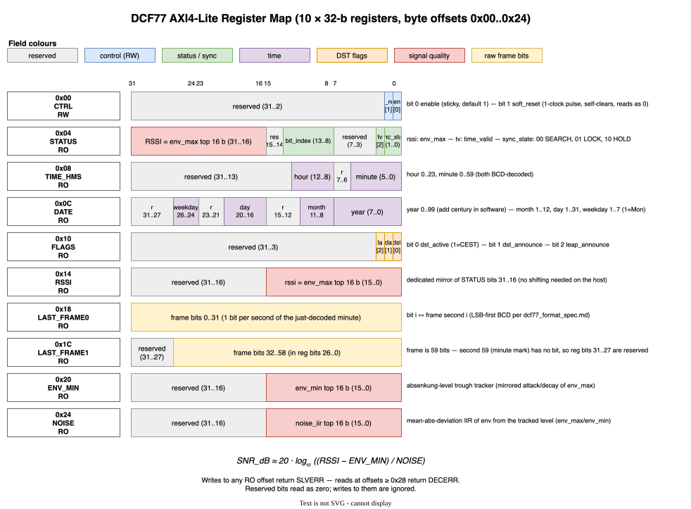

# DCF77 Receiver — Architecture, Performance and Usage

End-to-end reference for the **dcf77_axi_lite** receiver: what it does,
how the signal path is laid out, what every AXI4-Lite register means,
how it performs on real recordings, and how to integrate, build and
simulate it.

For protocol background see [`dcf77_format_spec.md`](dcf77_format_spec.md).
For the integrator's per-bit register tables (a subset of this file) see
[`dcf77_receiver_reference.md`](dcf77_receiver_reference.md). For repo
layout and contributor notes see the project [`README.md`](../README.md).

---

## 1. What this module is

A VHDL-2008 receiver and decoder for the DCF77 longwave time signal
(77.5 kHz, Mainflingen, Germany), packaged as an AXI4-Lite peripheral.

Two demodulation paths share the same RF front end:

- **AM** — amplitude-modulation envelope decoder. Decodes the 59-bit
  per-minute frame, the BCD-encoded date/time, the DST/leap flags, and
  exposes a per-second envelope SNR.
- **PM** — phase-modulation matched-filter decoder. Demodulates the
  Sequence-Inversion-Keyed (SIK) PRBS-9 phase modulation that DCF77 has
  carried since 1983. Recovers the same per-minute data ~27 dB earlier
  than the AM path (matched-filter processing gain), with an
  edge-protected SIK-signature minute mark.

Target platform is an AMD/Xilinx Artix-7 200 running a 125 MHz system
clock; the ADC stream is 14-bit signed samples at 125 MS/s. The entire
pipeline lives in a single clock domain.

Top-level entity: `dcf77_axi_lite`
(`src/dcf77/dcf77_axi_lite.vhd`). It is a thin wrapper around
`dcf77_core` (the actual receiver) plus the `axi_readmux` /
`axi_writemux` slave decoders.

---

## 2. Block diagram



```
  ADC (14 b signed, 125 MS/s)
    │
    ▼
  CIC₀ R=2   N=3   17 b   125 MHz single-cycle
  CIC₁ R=10  N=3   29 b   62.5 MS/s, multicycle ×2
  CIC₂ R=25  N=3   33 b   6.25 MS/s, multicycle ×20
    ▼  real, 22 b, 250 kS/s  (carrier still at 77.5 kHz)
    │
    ├──────────── sign-LO mixer ◀── NCO (25 b phase + phase_inc_offset)
    │                                       ▲
    ▼ I, Q (22 b, 250 kS/s)                  │
  CIC₃_I / CIC₃_Q   N=3, R=10                │
    ▼ I, Q (22 b, 25 kS/s) ─── PM hook       │
    │                                        │
    │             ┌──────────────────────────┴──────────┐
    │             │ Q-boxcar R=25  → 27 b @ 1 kS/s     │
    │             │       │                            │
    │             │       ▼                            │
    │             │  CORDIC atan2(Q, I) → 12 b signed φ │
    │             │       │                            │
    │             │       ▼                            │
    │             │  carrier_pll  (KP=10, KI=23)       │
    │             │   ├── proportional path             │
    │             │   ├── integral path (jam-mable)     │
    │             │   ├── lock_state (hysteretic Δf)   │
    │             │   └── snapshots → AXI telemetry    │
    │             └────────────────────────────────────┘
    ▼
  CIC₄_I R=25                               ▼ phase_err 9 b @ 2 kS/s
    ▼ I @ 22 b, 1 kS/s                      │
    │                                       ▼
    ▼                              ┌─────────────────────────────┐
  env = |I|+(3/8)|Q|                │ PM correlator (WITH_PM)     │
  (alpha-max+beta-min, no DSP)      │  4096×9 BRAM ring buffer    │
    ▼ 26 b unsigned, 1 kS/s         │  Single LFSR / single ALU   │
  CIC_ENV R=10, N=3                 │  ACQUIRE → LOCK → re-acq    │
    ▼ env @ 100 S/s                 │  sigma-delta chip DLL        │
    │                               │  pm_soft (12 b) @ 1 Hz       │
    ▼                               └──────────────┬──────────────┘
  bit_det @ 100 S/s                                │
   - free-running mod-100 sample counter           │ pm_soft sign + valid
   - anchor on first edge, run-on recovery         │
   - W1/W2/W3 windows + env_max / env_min IIRs     ▼
    ▼                              ┌─────────────────────────────┐
  AM frame_dec (PM_MODE=false)     │ PM frame_dec (PM_MODE=true) │
   - 59-bit shift register          │  43-bit shift register      │
   - external minute_mark in        │  edge-protected T=1 SIK     │
   - START_INDEX=0                  │  signature detection        │
   - BCD + parity + plausibility    │  START_INDEX=15             │
    ▼                               └──────────────┬──────────────┘
  AM time/date/flags                                ▼
                                    PM time/date/flags + pm_lock_qual
                  │                          │
                  └──────────┬───────────────┘
                             ▼
              ┌────────────────────────────────┐
              │ AXI4-Lite slave  (23 registers) │
              └────────────────────────────────┘
```

Diagram source: [`doc/dcf77-dataflow.drawio.svg`](dcf77-dataflow.drawio.svg).
The carrier-PLL signal flow is detailed in
[`doc/dcf77-carrier-pll.drawio`](dcf77-carrier-pll.drawio).

Total decimation from ADC (125 MS/s) to the AM bit detector (100 S/s) is
**1 250 000** = 500 (pre-mixer) × 250 (post-mixer per channel) × 10
(envelope CIC). The PM path operates at the upstream 2 kS/s phase tap
where the matched filter still has its full ~27 dB despreading gain.

---

## 3. Module breakdown

`src/dcf77/`:

| Entity                  | Purpose                                                              |
| ----------------------- | -------------------------------------------------------------------- |
| `dcf77_cic_dec`         | Generic CIC building block (instantiated 7× — pre-mixer real + post-mixer complex + envelope) |
| `dcf77_nco`             | 25-b phase-accumulator DDS with signed `phase_inc_offset`, sign-only I/Q |
| `dcf77_mixer`           | 22-b conditional-negate I/Q mixer                                    |
| `dcf77_q_boxcar`        | R=25 CIC on Q → 27 b @ 1 kS/s for the PLL                            |
| `dcf77_cordic`          | CORDIC atan2(Q, I) → 12-b signed phase (input to PM + PLL)            |
| `dcf77_carrier_pll`     | 2nd-order PI carrier loop, lock_state + telemetry snapshots          |
| `dcf77_env`             | Magnitude `\|I\|+(3/8)\|Q\|` (alpha-max+beta-min, no DSP)             |
| `dcf77_bit_det`         | AM symbol-structural detector @ 100 S/s, anchor on first edge        |
| `dcf77_pm_correlator`   | PM matched filter, single-LFSR/single-ALU, 4096×9 BRAM ring buffer   |
| `dcf77_frame_dec`       | Shared decoder body: AM mode (PM_MODE=false) + PM mode (PM_MODE=true) |
| `dcf77_core`            | Top-level RTL wiring (no AXI here). Contains `gen_pm : if WITH_PM`     |
| `axi_readmux`           | AXI4-Lite read decoder, generic-gated PM + PM_DEBUG blocks           |
| `axi_writemux`          | AXI4-Lite write decoder, jam-pulse decoding for PLL_I_STATE / PLL_OFFSET |
| `dcf77_axi_lite`        | Top-level shell: core + readmux + writemux + flat AXI ports          |

`inc/`:

| File                          | Purpose                                                        |
| ----------------------------- | -------------------------------------------------------------- |
| `dcf77_pkg.vhd`               | Status / control / override records, register-map constants, pack/unpack helpers |
| `dcf77_cic_widths_pkg.vhd`    | CIC stage widths (generated by `cic_pruning.py`, checked in)   |
| `axi4lite_interface_pkg.vhd`  | AXI4-Lite channel record types                                  |

---

## 4. AXI4-Lite register map



23 of the 64 word slots are used. All registers are 32 bits.

| Offset | RW    | Name              | Gate          | Content                                                                  |
| ------ | ----- | ----------------- | ------------- | ------------------------------------------------------------------------ |
| 0x00   | RW    | CTRL              | —             | enable, soft_reset, env_mode                                              |
| 0x04   | RO    | STATUS            | —             | sync_state, time_valid, PM_PRESENT, PM_DEBUG_PRESENT, pll_lock, anchor_held, bit_index, RSSI |
| 0x08   | RO    | TIME_HMS          | —             | AM-decoded minute, hour                                                   |
| 0x0C   | RO    | DATE              | —             | AM-decoded year, month, day, weekday                                      |
| 0x10   | RO    | FLAGS             | —             | AM-decoded DST/leap flags                                                 |
| 0x14   | RO    | RSSI              | —             | env_max top 16 b                                                          |
| 0x18   | RO    | LAST_FRAME0       | —             | AM raw frame bits 0..31                                                   |
| 0x1C   | RO    | LAST_FRAME1       | —             | AM raw frame bits 32..58                                                  |
| 0x20   | RO    | ENV_MIN           | —             | env_min trough tracker top 16 b                                           |
| 0x24   | RO    | NOISE             | —             | noise-MAD IIR top 16 b                                                    |
| 0x28   | RO    | SYNC_DIAG         | —             | sync_q, mm_q, cycle_in_min                                                |
| 0x2C   | RO    | SOFT_AM           | —             | AM bit LLR (12 b signed) + per-bit flags                                  |
| 0x30   | RO    | **SOFT_PM**       | WITH_PM       | PM bit LLR (12 b signed) + sec_index + valid + minute_mark                |
| 0x34   | R/W1C | **IRQ_FLAG**      | —             | Per-source sticky interrupt flags (see §4.1)                              |
| 0x38   | RO    | **PM_STATUS**     | WITH_PM       | pm_bit_index, pm_sync_state, pm_time_valid, pm_lock_qual                  |
| 0x3C   | RO    | **PM_TIME_HMS**   | WITH_PM       | PM-decoded minute, hour                                                   |
| 0x40   | RO    | **PM_DATE**       | WITH_PM       | PM-decoded year, month, day, weekday                                      |
| 0x44   | RO    | **PM_FLAGS**      | WITH_PM       | PM-decoded DST/leap flags                                                 |
| 0x48   | RO    | **PM_LAST_FRAME0**| WITH_PM       | PM raw frame bits 0..31                                                   |
| 0x4C   | RO    | **PM_LAST_FRAME1**| WITH_PM       | PM raw frame bits 32..58                                                  |
| 0x50   | RO    | **PLL_PHASE_FILT**| WITH_PM_DEBUG | Carrier-PLL LPF state, signed 29 b (snapshot)                             |
| 0x54   | RW    | **PLL_I_STATE**   | WITH_PM_DEBUG | Carrier-PLL integrator state (jam-write)                                  |
| 0x58   | RW    | **PLL_OFFSET**    | WITH_PM_DEBUG | NCO `phase_inc_offset` (jam-write)                                        |
| 0x5C   | RW    | **IRQ_MASK**      | —             | Per-source enable for the `irq` output line (see §4.1)                    |

Writes to read-only offsets return **SLVERR**. Reads at unmapped or
gate-disabled offsets return **DECERR**. Reads/writes at offsets ≥
`0x60` return DECERR.

### 4.1 Interrupt registers (IRQ_FLAG / IRQ_MASK)

The shell exposes a level-sensitive `irq` output port wired to
`OR(IRQ_FLAG & IRQ_MASK)`. Edge-detect logic in `dcf77_axi_lite`
captures the rising edges of nine source signals from the core's
`dcf77_status_type` and latches them into IRQ_FLAG's sticky bits.
The host clears them with W1C writes (write '1' to clear).

| Bit | Source                  | Trigger                                         |
| --- | ----------------------- | ----------------------------------------------- |
| 0   | `SECOND_TICK`           | Rising edge of `am_soft_valid` (1 Hz)            |
| 1   | `AM_MINUTE_MARK`        | Rising edge of AM `minute_mark`                  |
| 2   | `PM_MINUTE_MARK`        | Rising edge of PM SIK signature edge (WITH_PM)   |
| 3   | `AM_TIME_VALID_RISE`    | Rising edge of `time_valid` (fresh AM decode)    |
| 4   | `PM_TIME_VALID_RISE`    | Rising edge of `pm_time_valid` (WITH_PM)         |
| 5   | `AM_SYNC_LOST`          | `sync_state` transitioned out of LOCK            |
| 6   | `PM_SYNC_LOST`          | `pm_sync_state` transitioned out of LOCK (WITH_PM) |
| 7   | `PLL_LOCK_RISE`         | Carrier-PLL `lock_state` 0 → 1                   |
| 8   | `PLL_LOCK_FALL`         | Carrier-PLL `lock_state` 1 → 0                   |
| 31..9 | reserved              | reads 0; writes ignored                          |

- **IRQ_MASK reset value = 0** — the host must opt in to each source.
- **PM-only sources** (bits 2, 4, 6) never fire when `WITH_PM=false`
  (the underlying status fields stay at reset). The corresponding
  mask bits still round-trip in IRQ_MASK; they just never assert
  `irq`.
- **Edge-detect collisions**: if a source edge fires the same clock
  the host W1Cs the matching bit, the set wins (the edge is not
  lost).
- **Level vs edge `irq`**: the output is level-sensitive — it stays
  high until *all* unmasked flags are cleared. Wire this to the
  CPU's level-sensitive IRQ input.

When `WITH_PM=false`, software can still detect the absent PM stack
via `STATUS[3]` (PM_PRESENT) and skip the PM-source mask bits
entirely.

### Status capability bits

`STATUS[3]` (`PM_PRESENT`) and `STATUS[4]` (`PM_DEBUG_PRESENT`) are
synthesis-time constants OR'd into the readmux output. Software reads
`STATUS` once and conditionally exposes the PM and PLL-telemetry
register blocks based on these bits.

### RW PLL registers

`PLL_I_STATE` and `PLL_OFFSET` use simple jam semantics: **write the
desired value, read the current hardware value.** A write fires a
one-clock jam pulse into the carrier PLL's PI integrator (or NCO
offset). Reads sample the live HW value. Useful for forcing a coarse
acquisition (write a known offset) or for observing the loop response
to a step.

---

## 5. Synthesis generics

`dcf77_axi_lite` exposes the runtime defaults plus two synthesis gates.

| Generic           | Default      | Purpose                                                |
| ----------------- | ------------ | ------------------------------------------------------ |
| `K_ATK`           | 6            | env_max / env_min attack shift (1/2^K per sample)      |
| `K_DEC`           | 12           | env_max / env_min slow-decay shift (~4 s @ 1 kHz)      |
| `K_NOISE`         | 12           | noise-MAD IIR shift (~4 s @ 1 kHz)                      |
| `T_LOW_MIN`       | 90           | minimum low-pulse width @ 1 kS/s ticks                  |
| `T_BIT0_MAX`      | 110          | upper bound for bit-0 low pulse                         |
| `T_BIT1_MIN`      | 190          | lower bound for bit-1 low pulse                         |
| `T_BIT1_MAX`      | 210          | upper bound for bit-1 low pulse                         |
| `T_GAP_MINUTE`    | 1500         | minute-mark gap threshold (1500 ms)                     |
| `SAMPLE_RATE_HZ`  | 1000         | env_valid rate; converts T_* seconds → ticks            |
| `T_HOLD_SEC`      | 120          | sync_lock → sync_hold timeout                           |
| `T_SEARCH_SEC`    | 300          | sync_lock\|hold → sync_search timeout                   |
| `NCO_PHASE_INCR`  | 10_399_018   | 25-b NCO increment for 77.5 kHz at 250 kS/s             |
| **`WITH_PM`**     | `true`       | Synthesise the PM stack (correlator + PM frame_dec + PM registers) |
| **`WITH_PM_DEBUG`**| `false`     | Synthesise the carrier-PLL telemetry registers + jam datapath |

### `WITH_PM` tradeoffs

- `WITH_PM = true` (default) — full receiver including PM.
- `WITH_PM = false` — AM-only build. The PM correlator and the second
  `frame_dec` instance are not instantiated. Estimated saving:
  **1 BRAM tile + ~900 FF + ~600 LUT.** AXI registers `0x30,
  0x38–0x4C` return DECERR. `STATUS[3]` reads 0.

### `WITH_PM_DEBUG` tradeoffs

- `WITH_PM_DEBUG = false` (default) — production build. No PLL
  snapshot registers; no jam path from AXI into the PI integrator.
  `0x50/0x54/0x58` return DECERR. `STATUS[4]` reads 0.
- `WITH_PM_DEBUG = true` — exposes the carrier-PLL internals through
  `0x50/0x54/0x58`. Reads return the live HW value; writes jam a new
  value for one clock. Adds the snapshot flops + the override mux.

The two gates are independent: `WITH_PM=true, WITH_PM_DEBUG=false` is
the normal production setting; `WITH_PM=false` with either telemetry
setting builds an AM-only receiver.

---

## 6. AM signal chain

The AM path is the original receiver and matches the historical
v1 design:

1. **Pre-mixer CIC cascade** brings 125 MS/s real samples down to
   250 kS/s real, 22-b signed. The carrier still sits at 77.5 kHz.
2. **Sign-LO mixer** multiplies by an NCO at 77.5 kHz to produce
   complex I/Q at 250 kS/s.
3. **Post-mixer CIC₃_I / CIC₃_Q** decimate both channels to 25 kS/s.
4. **CIC₄_I** further decimates I to 1 kS/s. The Q channel is fed
   through `q_boxcar` (R=25) to 1 kS/s for the carrier PLL.
5. **Envelope** uses alpha-max+beta-min magnitude `|I|+(3/8)|Q|` —
   linear, monotonic, DSP-free.
6. **CIC_ENV** decimates the envelope to 100 S/s.
7. **bit_det** runs a symbol-structural detector at 100 S/s:
   free-running modulo-100 sample counter anchored on the first
   falling edge. Three windows per second: W1 (mm candidate),
   W2 (bit discriminator), W3 (carrier reference for the IIR).
   Drops anchor on 3-in-a-row mm candidates to recover from a
   wrong-phase initial lock.
8. **frame_dec** in AM mode buffers 59 bits per minute and runs BCD
   + parity + plausibility checks.

The AM SNR estimator runs continuously and exposes three registers:
`RSSI`, `ENV_MIN`, `NOISE`. Software computes
`SNR_dB ≈ 20·log10((RSSI − ENV_MIN)/NOISE)`.

---

## 7. PM signal chain

The PM path consumes the CORDIC phase tap (12-b signed @ 2 kS/s)
already needed by the carrier PLL — no extra mixer or CIC stages.

### 7.1 Carrier PLL

`dcf77_carrier_pll` closes a 2nd-order Type-II PI loop on the CORDIC
phase. Key parameters:

| Parameter         | Value      | Notes                                          |
| ----------------- | ---------- | ---------------------------------------------- |
| `KP_SHIFT`        | 10         | Proportional gain = 2⁻¹⁰                       |
| `KI_SHIFT`        | 23         | Integral gain = 2⁻²³                            |
| `I_FRAC_BITS`     | 10         | Sub-LSB precision on the integrator           |
| `LOOP_IIR_SHIFT`  | 4          | 20 Hz first-stage LPF on the loop input         |
| `LOCK_IIR_SHIFT`  | 14         | ~8 s τ slow IIR tracking the residual Δf       |
| `LOCK_IN_THR`     | 2¹¹ LSB    | |q_lock_iir| < threshold → in-band            |
| `LOCK_OUT_THR`    | 2¹³ LSB    | |q_lock_iir| ≥ threshold → out-band           |
| `LOCK_HOLD_TICKS` | 49152      | ~25 s sustained band-state before flipping     |

The `lock_state` output gates downstream signal-processing decisions
and is the primary input to the bit-detector's anchor logic.

When `WITH_PM_DEBUG=true`, the loop exposes three snapshots via AXI:
the filtered phase error (`PLL_PHASE_FILT`, R), the I-state of the PI
integrator (`PLL_I_STATE`, R/W), and the NCO offset itself
(`PLL_OFFSET`, R/W). Writes jam values for one cycle — useful for
coarse acquisition or step-response measurement.

### 7.2 PM correlator

`dcf77_pm_correlator` is a time-multiplexed matched filter against the
PRBS-9 chip stream that DCF77 transmits in each broadcast second.

- **Sample ring buffer**: 4096 × 9-bit BRAM, one Xilinx 36-kbit tile.
  Stores ~2 broadcast seconds of CORDIC-phase samples.
- **Single LFSR**: 9 flops with taps 5 & 9 reproduces the PRBS-9 chip
  stream (Hetzel 1988 polarity). One LFSR is shared across all
  hypotheses.
- **Single 28-b ALU**: serially evaluates all K hypotheses per
  ACQUIRE burst (K=463 per burst, 4 bursts per second). Cold
  acquisition < 2 s.
- **Sigma-delta chip DLL**: in TRACK mode the correlator runs three
  evaluations per second (locked − 1, locked, locked + 1) and adjusts
  `locked_offset` by ±1 sample/second to follow the ADC clock vs
  broadcast clock drift.
- **Output**: one signed 12-bit `pm_soft` per locked second (the SIK
  bit LLR). `pm_lock_qual` is a slow IIR of `|pm_soft|` exposing
  signal quality to the host.

The matched filter delivers ~27 dB despreading gain (10·log₁₀(512))
over coherent reception, which is what lets the PM decoder lock
~10 dB earlier than the AM path on weak signals.

### 7.3 Edge-protected T=1 SIK minute-mark detection

`dcf77_frame_dec` with `PM_MODE=true` watches the last 16 PM bits and
fires `minute_mark_out` when the SIK signature
`111111111100000`-followed-by-`0` is recognised.

The signature spans seconds 59 (always '0' in PM, unlike AM which
omits it), 0..9 (always '1' = PNS̄), and 10..14 (always '0' = PNS).
The 16-bit window therefore has **four "edge" bits** (positions 59, 0,
9, 10) that nail down the minute boundary, plus **twelve non-edge bits**
that are stable but less load-bearing.

To tolerate noisy reception without false-locking, the detector uses
an asymmetric error budget:

- **4 edge bits**: must match exactly (any error → skip this minute).
- **12 non-edge bits**: allow up to **T=1** error.

The math (T=1, 12 non-edge bits):
- Per-minute false-positive probability is `12·p` (vs `p` for T=0).
- At a typical marginal BER (p ≈ 0.1), per-minute hit probability
  jumps from `0.28` (T=0) to `0.43` (T=1), roughly halving the
  expected acquisition time.
- Going to T=2 brings the false-positive rate above the natural
  inter-minute spacing — `T=1` is the practical maximum.

The corpus (§8) empirically validates this: `dcf_3_5long`
(26 min, SNR 20 dB) acquired its first valid PM minute mark after
~25 minutes of TRACK — consistent with the binomial prediction at the
observed lock quality.

---

## 8. Performance

### 8.1 Corpus results

PM-correlator regression (`15_dcf77_pm_correlator_replay_tb`),
PHASE_ERR_V_CLOCKS = 62500 (live HW rate), 11/11 pass:

| Recording (site, duration)         | pm_lock_qual | pm_valid | pm_mm  | Notes                            |
| ---------------------------------- | ------------ | -------- | ------ | -------------------------------- |
| `dcf_strong` (synthetic, 60 s)     | 31992        | 57       | **1**  | reference: clean signal           |
| `synth` (synthetic, 60 s)          | ~29000       | 58       | 0      | no SIK in synth source            |
| `dcf_3_3` (ei2hh, 60 s)            | 15868        | 55       | **1**  | strong real signal                |
| `dcf_3_6` (pallas-flydog, 60 s)    | 23483        | 57       | **1**  | strong real signal                |
| `dcf_3_4` (185.227, 60 s)          | 2967         | 54       | 0      | marginal                          |
| `dcf_3_5` (cyhams, 60 s)           | 4790         | 50       | 0      | marginal                          |
| `dcf_3_7` (midskiwi, 60 s)         | 4066         | 47       | 0      | marginal                          |
| `dcf_3_1` (synthetic noise, 60 s)  | 2187         | 56       | 0      | marginal                          |
| `dcf_3_5long` (cyhams, **26 min**) | 4732         | 1552     | **1**  | marginal SNR 20 dB, T=1 fired     |
| `dcf_3_7long` (midskiwi, **23 min**)| 4442        | 1401     | 0      | marginal SNR 28 dB, T=1 not yet   |

The strong recordings clear pm_mm within their first available minute.
The marginal recordings need many minutes to roll a binomially-clean
SIK signature; `dcf_3_5long` rolled one in 26 min, confirming that
edge-protected T=1 is the right operating point for real-world
marginal reception.

Total wall time for the 11-config corpus at live HW rate: **~118 sec**
(2 min) using 8 parallel workers.

### 8.2 Resource estimate

| Resource | AM-only (`WITH_PM=false`) | AM + PM (`WITH_PM=true`) | + Debug (`WITH_PM_DEBUG=true`) |
| -------- | ------------------------- | ------------------------ | ------------------------------ |
| LUT      | ~1500                     | ~2100                    | ~2150                          |
| FF       | ~1600                     | ~2500                    | ~2560                          |
| DSP48E1  | 1                         | 1                        | 1                              |
| BRAM     | 0                         | 1                        | 1                              |

PM-stack delta is ~600 LUT + ~900 FF + 1 BRAM tile. The Debug delta is
~50 LUT + ~60 FF (snapshot flops + jam mux). DSP count is unchanged —
the PM correlator's accumulator uses ordinary fabric adders.

All figures are pre-synthesis estimates; the design has not yet been
through full Vivado place-and-route. Re-validate when the first
release build is taped.

### 8.3 Timing

Only the 17-bit CIC₀ integrators sit on the unconstrained 125 MHz
single-cycle path. All inner CIC stages and the bit_det / noise IIRs
get multicycle or false-path relief via `constraints/dcf77.xdc`. The
PM correlator's 28-b ALU also lives at the 125 MHz / sample-rate ratio,
so its adder has 62500× headroom (no constraint needed).

---

## 9. Usage

### 9.1 Compile order

`inc/` packages first (`dcf77_pkg.vhd`, `dcf77_cic_widths_pkg.vhd`,
`axi4lite_interface_pkg.vhd`), then `src/dcf77/` in any order. All
files are VHDL-2008.

Always apply `constraints/dcf77.xdc` (or its equivalent in your flow);
without it Vivado treats the inner-CIC adders as single-cycle paths
and over-pessimises timing.

### 9.2 Generics at instantiation

Defaults are silicon-faithful. A typical production instantiation:

```vhdl
u_dcf77 : entity work.dcf77_axi_lite
    generic map (
        WITH_PM       => true,    -- include PM stack
        WITH_PM_DEBUG => false    -- omit telemetry registers
    )
    port map (
        s_axi_aclk    => clk_125,
        s_axi_aresetn => arst_n,
        -- ... AXI4-Lite slave signals ...
        adc_sample    => adc_sfixed,
        adc_valid     => '1'      -- ADC is synchronous
    );
```

For an AM-only build (e.g. silicon-cost-constrained target), set
`WITH_PM => false` and ignore the PM register block on the host.

### 9.3 Host driver sketch

```c
#define DCF77_BASE  /* AXI4-Lite slave base address */

#define CTRL        (DCF77_BASE + 0x00)
#define STATUS      (DCF77_BASE + 0x04)
/* ... AM registers as documented in §4 ... */
#define SOFT_PM     (DCF77_BASE + 0x30)
#define PM_STATUS   (DCF77_BASE + 0x38)
#define PM_TIME_HMS (DCF77_BASE + 0x3C)

/* Synthesis capability detection */
int pm_present  (void) { return (read(STATUS) >> 3) & 1; }
int pm_debug    (void) { return (read(STATUS) >> 4) & 1; }

/* Pick AM or PM time based on which is locked first */
int read_time(struct dcf77_time *t)
{
    uint32_t st_am = read(STATUS);
    if (pm_present()) {
        uint32_t st_pm = read(PM_STATUS);
        if ((st_pm >> 8) & 1) {            /* pm_time_valid */
            decode_pm_time(t);
            return 1;
        }
    }
    if ((st_am >> 2) & 1) {                /* am time_valid */
        decode_am_time(t);
        return 1;
    }
    return 0;
}
```

When `WITH_PM_DEBUG = true`, the host can drive the carrier PLL by
writing a known frequency offset and integrator state during cold
acquisition:

```c
/* Force a coarse NCO offset (units: LSB of phase_inc_offset) */
write(PLL_OFFSET, target_offset_lsb);

/* Reset / preset the integrator (signed 28-b in I-frac LSBs) */
write(PLL_I_STATE, target_i_state);

/* Reads now return the live HW values */
int32_t cur_phase_filt = (int32_t)read(PLL_PHASE_FILT);
int32_t cur_i_state    = (int32_t)read(PLL_I_STATE);
int32_t cur_offset     = (int32_t)read(PLL_OFFSET);
```

Writes use simple jam semantics — there is no commit register and no
ordering between them; each AXI write fires a one-clock jam pulse the
moment the slave accepts the W beat.

Connecting `irq` to an interrupt controller and using the
`IRQ_MASK` / `IRQ_FLAG` registers:

```c
#define IRQ_FLAG          (DCF77_BASE + 0x34)
#define IRQ_MASK          (DCF77_BASE + 0x5C)
#define IRQ_SECOND_TICK   (1u << 0)
#define IRQ_AM_TIME_VALID (1u << 3)
#define IRQ_PM_TIME_VALID (1u << 4)
#define IRQ_PLL_LOCK_RISE (1u << 7)

void dcf77_isr_init(void)
{
    /* Unmask the events we want to handle. */
    write(IRQ_MASK, IRQ_SECOND_TICK | IRQ_AM_TIME_VALID
                  | IRQ_PM_TIME_VALID | IRQ_PLL_LOCK_RISE);
}

void dcf77_isr(void)
{
    uint32_t flags = read(IRQ_FLAG);
    /* W1C all serviced bits up front so a new edge during the ISR
     * sets a fresh flag (handled on the next ISR invocation). */
    write(IRQ_FLAG, flags);

    if (flags & IRQ_SECOND_TICK)   handle_second_tick();
    if (flags & IRQ_AM_TIME_VALID) print_am_time();
    if (flags & IRQ_PM_TIME_VALID) print_pm_time();
    if (flags & IRQ_PLL_LOCK_RISE) log_pll_locked();
}
```

The `irq` line is level-sensitive, so the CPU's interrupt controller
should be configured for level (not edge) triggering. W1C-clearing
all serviced flags is what drops `irq` low.

### 9.4 Software-side PM minute-mark scoring

The hardware PM minute-mark fires on the *first* clean SIK signature
match. Software that wants softer per-minute confidence (e.g. for
combining with the AM path or for sub-T=1 statistics on weak signals)
can poll `SOFT_PM` once per `IRQ_FLAG.SECOND_TICK`, accumulate 60 LLR
samples per minute, and compute its own correlation with the expected
SIK polarity pattern. The `pm_sec_index` field in `SOFT_PM` makes the
LLR atomically tagged with its source second.

### 9.5 Build & test

```sh
# Activate a venv with vunit_hdl + scipy + numpy installed first.

# All tests (~3 min in parallel).
python3 simulation/scripts/run.py -p 8

# Specific subsuite.
python3 simulation/scripts/run.py -p 8 "*pm_correlator_replay*"

# Verbose info() logging (per-bit / per-minute lines).
python3 simulation/scripts/run.py -v "*rx_replay*smoke*"

# Clean rebuild.
python3 simulation/scripts/run.py --clean
```

Tests run under GHDL with `--std=08 -fsynopsys -frelaxed`. Build
artefacts land in `vunit_out/` (gitignored).

### 9.6 Replay from a real recording

End-to-end PM corpus regeneration from a USB-demodulated WAV:

```sh
# 1. Drop the WAV into samples/.
cp dcf_xx.wav samples/

# 2. Preprocess into derived/<stem>.if.s16 + .if.meta.
#    --if-hz must match the actual DCF77 carrier position in the WAV
#    (default 5000 Hz; pass 3000 for the typical USB-74.5 kHz dial).
python3 simulation/scripts/wav_to_if.py --in samples/dcf_xx.wav \
    --out simulation/derived/dcf_xx.if.s16 \
    --meta simulation/derived/dcf_xx.if.meta \
    --if-hz 3000 --force

# 3. Refine the IF offset via FFT peak measurement.
python3 simulation/scripts/measure_if_hz.py dcf_xx

# 4. Capture phase_err to a .pe.bin via 14_phase_err_capture_tb.
python3 simulation/scripts/run.py "*phase_err_capture*dcf_xx*"

# 5. Replay through the PM correlator (default 60 s of input;
#    DCF77_PM_REPLAY_LIMIT=0 for the full duration).
DCF77_PM_REPLAY_LIMIT=0 python3 simulation/scripts/run.py \
    "*pm_correlator_replay*dcf_xx*"
```

### 9.7 Testbench inventory

| TB                                        | Coverage                                       |
| ----------------------------------------- | ---------------------------------------------- |
| `00_dcf77_cic_dec_tb`                     | Generic CIC building block                     |
| `01_dcf77_nco_tb`                         | NCO phase accumulator                          |
| `03_dcf77_bit_det_tb`                     | Symbol-structural AM bit detector              |
| `04_dcf77_frame_dec_tb`                   | Frame decoder (AM + PM mode)                   |
| `05_dcf77_axi_lite_tb`                    | AXI slave register map                         |
| `06_dcf77_rx_replay_tb`                   | Baseband I/Q replay (back-end only)            |
| `07_dcf77_if_replay_tb`                   | Full IF replay (NCO + mixer + PLL closure)     |
| `10_dcf77_core_tb`                        | Top-level core integration                     |
| `11_dcf77_pm_correlator_tb`               | PM correlator unit                             |
| `13_dcf77_cordic_tb`                      | CORDIC atan2                                   |
| `14_dcf77_pm_if_replay_tb`                | Full PM IF replay                              |
| `15_dcf77_pm_correlator_replay_tb`        | PM correlator from `.pe.bin` (corpus regression)|
| `16_dcf77_phase_err_capture_tb`           | Captures `.pe.bin` from `.if.s16` via 14-stage IF |

---

## 10. Operational notes

### 10.1 Reading the decoded time

1. Read `STATUS`. Check bit 3 (`PM_PRESENT`).
2. If PM is present: read `PM_STATUS` first; if `pm_time_valid` (bit 8)
   is `1`, use the PM time/date/flags registers.
3. Otherwise check `STATUS[2]` (`time_valid`) for the AM path and use
   the AM time/date/flags registers.

The PM path locks ~10 dB earlier than AM on weak signals and the
`pm_lock_qual` register exposes the running lock confidence; on strong
signals both paths produce identical decoded values, so a "prefer PM
when both are locked" host policy is robust.

### 10.2 Sync-state machines

AM `sync_state` (`STATUS[1:0]`):

| Code  | Name    | Meaning                                                           |
| ----- | ------- | ----------------------------------------------------------------- |
| `00`  | SEARCH  | No minute mark yet, or > T_SEARCH_SEC since the last one          |
| `01`  | LOCK    | Minute mark within T_HOLD_SEC; frame buffer in step               |
| `10`  | HOLD    | Was LOCK; > T_HOLD_SEC without a new mark; alignment uncertain   |

PM `pm_sync_state` (`PM_STATUS[7:6]`):

| Code  | Name    | Meaning                                                           |
| ----- | ------- | ----------------------------------------------------------------- |
| `00`  | FILL    | Sample ring buffer below threshold; no ACQUIRE running yet        |
| `01`  | ACQUIRE | K-way search across all 463 chip-offset hypotheses per second     |
| `10`  | LOCK    | TRACK mode with 3-way DLL; one pm_soft emitted per locked second  |
| `11`  | HOLD    | Lost LOCK; signal too weak for the LOSS_THR for K_LOSS seconds    |

### 10.3 Reset semantics

- `s_axi_aresetn` resets the whole module (AXI slave + receiver core).
- `CTRL.soft_reset` (write a pulse to bit 1) resets just the receiver
  core; the AXI slave keeps responding. The bit is self-clearing.
- `CTRL.enable` (bit 0, sticky) gates `adc_valid` into the pipeline.

---

## 11. Known limitations

- **Synthesis not yet validated.** Resource numbers are pre-PnR
  estimates from the WITH_PM gating analysis. First Vivado build will
  refine them.
- **Level-sensitive interrupt only.** The `irq` output stays high
  while any unmasked `IRQ_FLAG` bit is set. Hosts that need edge-
  triggered semantics should configure their interrupt controller
  accordingly or use the W1C clear as the de-assertion gesture.
- **PM minute-mark hardware is T=1.** Soft-metric T=0..k MLD lives in
  the host software; the hardware delivers raw `pm_soft` per second
  and the host accumulates over arbitrary windows.
- **Single ADC clock domain.** If the ADC has its own clock, add a CDC
  FIFO upstream of `dcf77_axi_lite`.
- **No watchdog on PM lock-loss.** The PM correlator re-enters ACQUIRE
  on its own; the host sees `pm_sync_state` transition LOCK → HOLD →
  ACQUIRE through `PM_STATUS`.

---

## 12. References

- Hetzel, P. (1987). *Time dissemination via DCF77 using a pseudo-random
  phase noise modulation*. PhD dissertation, U. Stuttgart.
  [`doc/Hetzel_1987_Dissertation.pdf`](Hetzel_1987_Dissertation.pdf).
- Hetzel, P. (1988). Proc. EFTF 1988.
  [`doc/5_1988_Hetzel_-_Proc_EFTF_88.pdf`](5_1988_Hetzel_-_Proc_EFTF_88.pdf).
- Gaisler structured two-process VHDL coding style.
  [`doc/structdes.pdf`](structdes.pdf) and
  [`doc/vhdl2proc.pdf`](vhdl2proc.pdf).
- Format spec: [`doc/dcf77_format_spec.md`](dcf77_format_spec.md).
- Integrator reference (per-bit tables):
  [`doc/dcf77_receiver_reference.md`](dcf77_receiver_reference.md).
