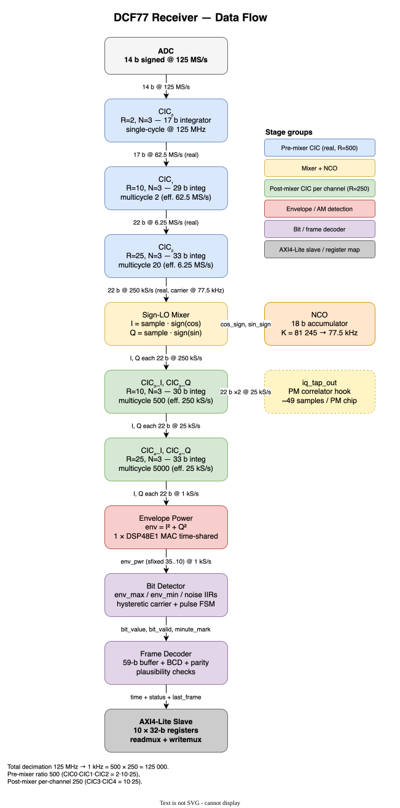
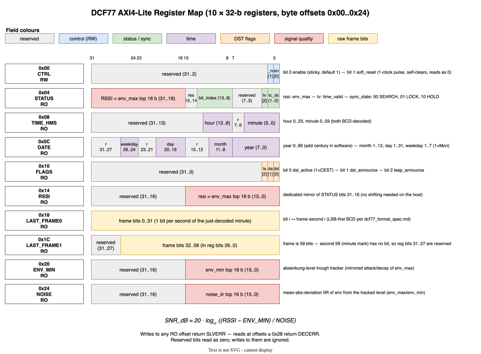

# DCF77 Receiver — Integrator Reference

This document describes the **dcf77_axi_lite** receiver module from an
integrator's point of view: what it does, what data flows through it, and what
the host reads to recover the decoded time and signal-quality information. It
focuses on the **AM decode path and its registers**.

> **Scope** — this reference concentrates on the AM receiver and the
> signal-quality registers. For the complete picture — the PM (PSK/SIK) decoder
> stack, the PM / IRQ / carrier-PLL register blocks, and the `WITH_PM` /
> `WITH_PM_DEBUG` synthesis generics — see
> [`dcf77_architecture.md`](dcf77_architecture.md). The **authoritative,
> complete register map** lives in [`../README.md`](../README.md); the AXI4-Lite
> slave structure and coding style are in
> [`axi4lite_interface.md`](axi4lite_interface.md).

For protocol details refer to `doc/dcf77_format_spec.md`. For project layout,
test infrastructure, and developer notes see `README.md` at the repo root.

---

## 1. What this module is

A receiver and decoder for the DCF77 longwave time-signal (77.5 kHz,
Mainflingen, Germany). It takes a raw 14-bit signed ADC stream at 125 MS/s on
one side and presents the decoded date/time plus signal-quality information
through an **AXI4-Lite slave** on the other. It decodes both the AM second marks
and — when built with `WITH_PM` — the phase-modulated (PSK/SIK) signal, which
reuses the same CORDIC phase output.

Top-level entity is `dcf77_axi_lite` (see `src/dcf77/dcf77_axi_lite.vhd`). It is
a thin wrapper that instantiates `dcf77_core` (the actual receiver) plus the
`axi_readmux` / `axi_writemux` slave decoders and `dcf77_irq_gen`.

---

## 2. Block diagram and data flow



Diagram source: `doc/dcf77-dataflow.drawio.svg`. The SVG embeds the draw.io XML
— open it directly in draw.io / diagrams.net to edit.

```
  ADC  (14 b signed, 125 MS/s)
    │
    ▼
  CIC0 (R=2,  N=3)  17 b, single-cycle              125 MHz
  CIC1 (R=10, N=3)  29 b, multicycle 2              62.5 MS/s
  CIC2 (R=25, N=3)  33 b, multicycle 20             6.25 MS/s
    │  real-valued, 250 kS/s (residual carrier)
    ▼
  sign-LO mixer  ◀── NCO (25-b acc, +phase_inc_offset)
    │  I, Q @ 250 kS/s                       ▲
    ▼                                        │ phase_inc_offset
  i_boxcar / q_boxcar (R=125)                │
    │  I, Q @ 2 kS/s                         │
    ▼                                        │
  CORDIC (I/Q → polar)                       │
    ├── mag[19b] ─► mag_iir(20 Hz) ─► env_dec(/10) ─► env @ 200 S/s
    │                                          │
    │                                     env_tracker (env_max/min/noise + edge)
    │                                          │
    │                                       bit_det @ 200 S/s
    │                                          │  (gated by pll_lock)
    │                                       frame_dec (59-b buffer + BCD/parity)
    │                                          │
    └── phase[12b] ─┬─ carrier_pll (PI) ─► phase_inc_offset ─► NCO
                    ├─ phase_quality ─► pll_lock
                    └─ pm_correlator ─► pm_frame_dec   (WITH_PM)
                                             │
                              AXI4-Lite slave (status_out, PM fields)
```

`bit_det` runs over a free-running modulo-`BIT_PERIOD` (=200) counter anchored on
the first falling edge: W1 `[0..20)` flags minute-mark candidates
(`acc_W1 > 7·env_max`), W2 `[20..40)` discriminates the bit
(`acc_W2 < 0.578·iir_high` → bit-1), W3 `[40..200)` feeds the `iir_high` carrier
reference; three consecutive mm candidates drop the anchor (wrong-phase recovery).

**Total decimation** from ADC (125 MS/s) to the AM bit detector (200 S/s) is
**625 000** = 2 (CIC0) × 10 (CIC1) × 25 (CIC2) × 125 (post-mixer boxcar) × 10
(envelope decimator).

The entire pipeline lives in one 125 MHz clock domain; inner stages advance on
clock-enable strobes, and `set_multicycle_path` XDC constraints (see
`constraints/dcf77.xdc`) relax timing on them.

---

## 3. Top-level interface

Entity `dcf77_axi_lite` exposes the conventional flat AXI4-Lite slave ports plus
an ADC stream port:

| Port                       | Direction | Width | Description                                          |
| -------------------------- | --------- | ----- | ---------------------------------------------------- |
| `s_axi_aclk`               | in        | 1     | AXI clock = receiver clock = 125 MHz                  |
| `s_axi_aresetn`            | in        | 1     | active-low synchronous reset                          |
| `s_axi_awaddr`             | in        | 8     | write address                                        |
| `s_axi_awprot`             | in        | 3     | write protection (unused, ignored)                    |
| `s_axi_awvalid` / `awready`| in/out    | 1     | write-address handshake                              |
| `s_axi_wdata`              | in        | 32    | write data                                           |
| `s_axi_wstrb`              | in        | 4     | per-byte write enables                                |
| `s_axi_wvalid` / `wready`  | in/out    | 1     | write-data handshake                                 |
| `s_axi_bresp` / `bvalid` / `bready` | out/out/in | 2/1/1 | write response (OKAY/SLVERR)                |
| `s_axi_araddr`             | in        | 8     | read address                                         |
| `s_axi_arprot`             | in        | 3     | read protection (unused)                              |
| `s_axi_arvalid` / `arready`| in/out    | 1     | read-address handshake                               |
| `s_axi_rdata`              | out       | 32    | read data                                            |
| `s_axi_rresp`              | out       | 2     | read response (OKAY/SLVERR/DECERR)                   |
| `s_axi_rvalid` / `rready`  | out/in    | 1     | read-data handshake                                  |
| `irq`                      | out       | 1     | interrupt (any unmasked `IRQ_FLAG` bit set)           |
| `adc_sample`               | in        | sfixed(13 downto 0) | signed ADC sample (two's complement) |
| `adc_valid`                | in        | 1     | sample-valid strobe (typically tied high)             |

The 8-bit address space gives 64 word registers; the map spans `0x00`–`0x60`.
Unimplemented offsets, and register blocks disabled by a generic, return
`DECERR`. The `adc_sample`/`adc_valid` pair is assumed synchronous to
`s_axi_aclk`; if the ADC has its own clock, add a CDC FIFO upstream.

---

## 4. Generic parameters

`dcf77_core` (and thus `dcf77_axi_lite`) exposes integration/testbench generics.
Defaults are silicon-faithful:

| Generic          | Default      | Meaning                                               |
| ---------------- | ------------ | ----------------------------------------------------- |
| `K_ATK`          | 5            | env_max / env_min attack shift (~160 ms @ 200 S/s)     |
| `K_DEC`          | 11           | env_max / env_min slow-decay shift (~10 s)             |
| `K_NOISE`        | 11           | noise-MAD IIR shift (~10 s)                            |
| `DERIV_DELAY`    | 2            | slope-detection window (samples @ 200 S/s)             |
| `K_SLOPE`        | 2            | falling-edge slope threshold (relative to env_max)     |
| `K_REF`          | 2            | carrier-reference IIR shift in bit_det                 |
| `SAMPLE_RATE_HZ` | 200          | envelope tick rate; converts seconds → ticks           |
| `T_HOLD_SEC`     | 120          | sync_lock → sync_hold timeout (seconds)               |
| `T_SEARCH_SEC`   | 300          | sync_lock/hold → sync_search timeout (seconds)        |
| `NCO_PHASE_INCR` | 10 399 018   | 25-b NCO increment for 77.5 kHz at the 250 kS/s tick   |
| `WITH_PM`        | true         | build the PM (PSK/SIK) decode stack + PM registers     |
| `WITH_PM_DEBUG`  | false        | build the carrier-PLL telemetry / override registers   |

The `CTRL.env_mode` bit selects the envelope estimator (`0` = `abs(I)`, `1` =
`|I| + 3/8·|Q|`) and resets to `0`. The `bit_det` window bounds (`BIT_PERIOD`,
`W1_END`, `W2_END`, `W3_END`) and LLR shifts are further generics on
`dcf77_bit_det`; see `src/dcf77/dcf77_core.vhd` for the full instantiation.

---

## 5. AXI4-Lite register map



Diagram source: `doc/dcf77-registers.drawio.svg`.

The **authoritative, complete register map** (all offsets `0x00`–`0x60`,
including the PM, IRQ and carrier-PLL blocks) is tabulated in
[`../README.md`](../README.md). The AM-decode subset covered by this reference:

| Offset | RW  | Name        | Content                                  |
|--------|-----|-------------|------------------------------------------|
| 0x00   | RW  | CTRL        | enable, soft_reset, env_mode             |
| 0x04   | RO  | STATUS      | sync_state, time_valid, pll_lock, bit_index, RSSI |
| 0x08   | RO  | TIME_HMS    | minute, hour                             |
| 0x0C   | RO  | DATE        | year, month, day, weekday, DST/leap flags |
| 0x14   | RO  | RSSI        | env_max top 16 b                         |
| 0x18   | RO  | LAST_FRAME0 | raw frame bits 0..31                     |
| 0x1C   | RO  | LAST_FRAME1 | raw frame bits 32..58                    |
| 0x20   | RO  | ENV_MIN     | env_min top 16 b                         |
| 0x24   | RO  | NOISE       | noise-MAD IIR top 16 b                   |

> **Changed from earlier revisions**: there is no longer a separate `FLAGS`
> register at `0x10` (that offset is reserved / DECERR). The DST and
> leap-second flags now live in `DATE` bits 29..27.

Writes to a read-only offset return **SLVERR**; reads of unimplemented offsets
or generic-disabled blocks return **DECERR**.

---

## 6. Per-register bit definitions (AM subset)

Bits not described below are reserved and read as zero.

### 6.1 `CTRL` — offset 0x00 — read/write

| Bits   | Field        | RW  | Description                                                      |
| ------ | ------------ | --- | ---------------------------------------------------------------- |
| 0      | `enable`     | RW  | `1` (default) lets ADC samples flow into the pipeline; `0` gates the chain, freezes state. |
| 1      | `soft_reset` | W   | Writing `1` resets the core for exactly one clock; reads back as `0` (self-clearing pulse). |
| 2      | `env_mode`   | RW  | Envelope estimator: `0` (default) = `abs(I)`, `1` = `|I| + 3/8·|Q|`. |
| 31..3  | reserved     | —   | Read as 0. Writes ignored.                                       |

The default `CTRL` value after `aresetn` is `0x0000_0001` (enable on, env_mode
off = abs(I), soft_reset clear).

### 6.2 `STATUS` — offset 0x04 — read-only

| Bits    | Field               | Description                                                  |
| ------- | ------------------- | ------------------------------------------------------------ |
| 1..0    | `sync_state`        | `00`=SEARCH, `01`=LOCK, `10`=HOLD. See §7.4.                |
| 2       | `time_valid`        | `1` when the most recently completed AM minute frame passed parity + plausibility. |
| 3       | `pm_present`        | Build-time capability bit: `1` if `WITH_PM`.                 |
| 4       | `pm_debug_present`  | Build-time capability bit: `1` if `WITH_PM_DEBUG`.          |
| 5       | `pll_lock`          | Carrier-PLL lock indicator (gates AM decode into frame_dec). |
| 6       | `anchor_held`       | bit_det has a second-grid anchor.                            |
| 13..8   | `bit_index`         | Current position within the minute, 0..58 (59 = frame full). |
| 31..16  | `rssi`              | Top 16 bits of the `env_max` IIR (carrier-on amplitude proxy). |

### 6.3 `TIME_HMS` — offset 0x08 — read-only

The decoded time-of-day from the most recently successfully parsed minute frame.

| Bits    | Field    | Description                          |
| ------- | -------- | ------------------------------------ |
| 5..0    | `minute` | 0..59                                 |
| 12..8   | `hour`   | 0..23                                 |
| others  | reserved | 0                                     |

Reading `TIME_HMS` latches `DATE` into `SHADOW` (0x60) on the same cycle, so a
follow-up `SHADOW` read is coherent with this `TIME_HMS` value.

### 6.4 `DATE` — offset 0x0C — read-only

| Bits    | Field           | Description                          |
| ------- | --------------- | ------------------------------------ |
| 7..0    | `year`          | last two digits, 0..99 (add century in software) |
| 11..8   | `month`         | 1..12                                |
| 20..16  | `day`           | 1..31                                |
| 26..24  | `weekday`       | 1=Mon … 7=Sun                        |
| 27      | `dst_active`    | `1` during CEST (UTC+2); `0` for CET (UTC+1) |
| 28      | `dst_announce`  | set in the hour before a DST switch  |
| 29      | `leap_announce` | set in the hour before a leap second |
| others  | reserved        | 0                                    |

### 6.5 `RSSI` — 0x14, `ENV_MIN` — 0x20, `NOISE` — 0x24 — read-only

Each carries a 16-bit magnitude in bits 15..0 (upper bits reserved):

- `RSSI` — top 16 b of the adaptive `env_max` peak detector (carrier-on level;
  also mirrored in `STATUS[31:16]`).
- `ENV_MIN` — top 16 b of the adaptive trough tracker (absenkung level).
- `NOISE` — top 16 b of the running mean-absolute-deviation of the envelope from
  the currently-tracked level. Feeds the host SNR estimate (§7.3).

### 6.6 `LAST_FRAME0` — 0x18, `LAST_FRAME1` — 0x1C — read-only

The raw 59-bit frame from the most recently completed minute: `LAST_FRAME0` holds
bits 0..31, `LAST_FRAME1` holds bits 32..58 (bits 31..27 reserved — second 59 is
the minute mark and carries no data bit). Useful for host-side parity/plausibility.

---

## 7. Operational notes

### 7.1 Reading the decoded time

1. Poll `STATUS` until `time_valid` (bit 2) is `1`.
2. Read `TIME_HMS` and `DATE` (DST/leap flags are in `DATE` bits 29..27).

The decoded values correspond to the **most recently completed** minute. DCF77
broadcasts the time of the upcoming minute during the preceding 60 seconds, so
the frame that encoded minute M finishes decoding at the start of minute M.

`time_valid` clears at the next minute mark and is re-asserted only if the new
frame passes parity and plausibility. Between minute marks the register values
are stable.

### 7.2 Reset and enable semantics

* `s_axi_aresetn` resets the whole module (AXI slave + receiver core).
* `CTRL.soft_reset` (bit 1, write pulse) issues a one-clock synchronous reset to
  just the receiver core — the AXI slave keeps responding. The bit reads back `0`.
* `CTRL.enable` (bit 0, sticky) gates `adc_valid` into the pipeline. Cleared, the
  pipeline freezes; re-asserted, it resumes. Useful for pausing without a reset.

### 7.3 SNR estimation (host-side)

```
SNR_dB ≈ 20 · log10( (RSSI − ENV_MIN) / NOISE )
```

* `(RSSI − ENV_MIN)` is the modulation depth — carrier-on minus absenkung level
  (≈ 85 % of carrier for a clean DCF77 signal).
* `NOISE` is the running MAD of the envelope from the tracked level: small for a
  clean signal, growing under weak/interfered conditions.

The estimator updates continuously at the 200 S/s envelope rate, so the registers
are eventually-consistent. Wait a few seconds after gain/antenna changes for the
IIRs to settle.

### 7.4 Sync-state machine

`STATUS[1:0]` is forced to `SEARCH` while `pll_lock` (STATUS bit 5) is `0`. Once
the carrier PLL is locked it follows `bit_det`:

| `STATUS[1:0]` | Name   | Meaning                                                                 |
| ------------- | ------ | ---------------------------------------------------------------------- |
| `00`          | SEARCH | No carrier lock, or no anchor yet — hunting for synchronisation.        |
| `01`          | LOCK   | Locked and tracking minute marks in step with broadcast seconds.       |
| `10`          | HOLD   | Locked with an anchor but minute marks have lapsed; alignment not guaranteed. |
| `11`          | reserved (not generated)                                               |

The `T_HOLD_SEC` / `T_SEARCH_SEC` generics bound the LOCK→HOLD→SEARCH demotion
when minute marks stop arriving.

---

## 8. Resource and timing notes

The receiver is small relative to a mid-size Artix-7. Indicative notes (see
`dcf77_architecture.md` for measured figures):

- Only the 17-bit `CIC0` integrators sit on the unconstrained 125 MHz
  single-cycle path; all inner CIC / boxcar / IIR stages get multicycle or
  false-path relief via `constraints/dcf77.xdc`.
- Envelope magnitude is produced by the time-shared `dcf77_cordic_atan2`
  (vectoring CORDIC), not a multiplier-based `I² + Q²` — no DSP48 is required for
  the envelope.
- The PM correlator (`WITH_PM`) adds a BRAM tile for its phase-error ring buffer
  plus the matched-filter logic; with `WITH_PM=false` that cost drops out.

---

## 9. Integration tips

* Compile order: `inc/` packages first
  (`dcf77_pkg.vhd`, `dcf77_cic_widths_pkg.vhd`, `axi4lite_interface_pkg.vhd`),
  then `src/dcf77/` in any order. All files are VHDL-2008.
* Always apply `constraints/dcf77.xdc` (or its equivalent); without it Vivado
  treats the inner-CIC adders as single-cycle paths and over-pessimises.
* `dcf77_core` exposes `phase_err_out` (the 12-b CORDIC phase). Inside
  `dcf77_axi_lite` it feeds the carrier PLL and PM correlator; at your top level
  you can leave it internal.
* Re-run `simulation/scripts/cic_pruning.py` only when changing the CIC topology
  (R values / widths). The output `inc/dcf77_cic_widths_pkg.vhd` is checked in.
* For end-to-end validation against a real recording, see the **Replay test**
  section of `README.md`.

---

## 10. Software pseudo-code

A minimal host driver (see `sw/` for the actual bare-metal C driver):

```c
#define DCF77_BASE   /* mapping of the slave */

#define CTRL         (DCF77_BASE + 0x00)
#define STATUS       (DCF77_BASE + 0x04)
#define TIME_HMS     (DCF77_BASE + 0x08)
#define DATE         (DCF77_BASE + 0x0C)
#define RSSI         (DCF77_BASE + 0x14)
#define LAST_FRAME0  (DCF77_BASE + 0x18)
#define LAST_FRAME1  (DCF77_BASE + 0x1C)
#define ENV_MIN      (DCF77_BASE + 0x20)
#define NOISE        (DCF77_BASE + 0x24)

void dcf77_soft_reset(void)        { write(CTRL, 0x3); /* enable + reset pulse */ }
void dcf77_enable(int en)          { write(CTRL, en & 1); }

int dcf77_time_valid(void)         { return (read(STATUS) >> 2) & 1; }
int dcf77_sync_state(void)         { return read(STATUS) & 0x3; }
int dcf77_bit_index(void)          { return (read(STATUS) >> 8) & 0x3F; }

struct dcf77_time {
    uint8_t year, month, day, weekday, hour, minute;
    uint8_t dst_active, dst_announce, leap_announce;
};

void dcf77_read_time(struct dcf77_time *t)
{
    uint32_t hms  = read(TIME_HMS);
    uint32_t date = read(DATE);          /* DST/leap flags live in DATE */
    t->minute       =  hms         & 0x3F;
    t->hour         = (hms  >>  8) & 0x1F;
    t->year         =  date        & 0xFF;
    t->month        = (date >>  8) & 0x0F;
    t->day          = (date >> 16) & 0x1F;
    t->weekday      = (date >> 24) & 0x07;
    t->dst_active   = (date >> 27) & 1;
    t->dst_announce = (date >> 28) & 1;
    t->leap_announce= (date >> 29) & 1;
}

double dcf77_snr_db(void)
{
    uint32_t r  = read(RSSI)    & 0xFFFF;
    uint32_t mn = read(ENV_MIN) & 0xFFFF;
    uint32_t n  = read(NOISE)   & 0xFFFF;
    if (n == 0 || r <= mn) return -INFINITY;
    return 20.0 * log10((double)(r - mn) / (double)n);
}
```

---

*Covers the current chain: CIC0..CIC2 pre-mixer (R=2·10·25), sign-LO mixer,
R=125 I/Q boxcars, CORDIC envelope/phase, 200 S/s AM bit detector, and the
env_max / env_min / noise-MAD SNR estimator. See `dcf77_architecture.md` for the
PM stack and measured resource/performance figures.*
